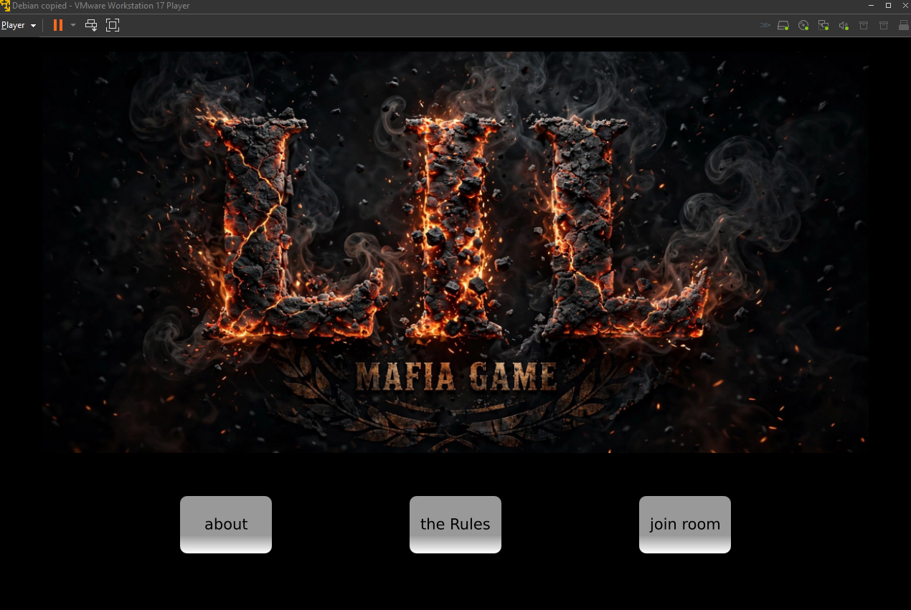

Mafia Nights
Real-time multiplayer social deduction game for Android built with Qt 6.5.3 QML & Firebase Realtime Database.

A real-time social deduction game for 8+ players. Day phase is discussion and voting, night phase is using role abilities. Single-message chat system to increase mystery.

🎭 Roles
Mafia Team:

Boss - Kills at night
Mafia - Blocks one player's ability at night
Silencer - Silences a player for the next day
City Team:

Mayor - Vote counts as 2
Sniper - If he kills a non-mafia, he dies too
Medic - Saves one player at night
Kid - Can reveal any player's role
Citizen - Votes during day
✨ Features
Unlimited rooms by room name
Prevents joining after game started
Real-time chat (one active message per player)
Smart voting system + Mayor x2 vote
Automatic 60s Day/Night cycle
Automatic win detection
Mafia team can see each other only
🛠️ Tech Stack
Qt 6.5.3 QML / Qt Quick
C++ Backend with QNetworkAccessManager
Firebase Realtime Database (REST API)
Android arm64-v8a
🔥 Firebase Structure
JSON
roomName/
  ├── count: int
  
  ├── started: 0/1
  
  ├── isNight: 0/1
  
  ├── players/{name}: {name, count}
  
  ├── roles/{name}: string
  
  ├── chat/{name}: {name, message}
  
  ├── votes/{name}: int
  
  ├── killed/{name}: "true"
  
  └── nightState/
  
      ├── blocked/{name}: "true"
      
      ├── saved/{name}: "true"
      
      └── silenced/{name}: "true"

🚀 How to Run
C++
// backend.h
QString base = "https://YOUR-PROJECT.firebaseio.com/";
Bash
Kit: Android Qt 6.5.3 Clang arm64-v8a
Build Settings: ANDROID_ABIS = arm64-v8a
Build & Run
🎮 How to Play
Text
1. Join the same room name (min 8 players)
2. First player (count == 1) auto distributes roles
3. Day: Discuss and vote
4. Night: Use your role ability
5. Win: Mafia == 0 => City Wins, Mafia >= City => Mafia Wins
🔒 Anti-Join Logic
C++
if(m_started == 1){
    m_note = "Game already started! You can't join.";
    return;
}

# MAFIA GAME - Embedded Linux Support

Embedded Linux & Qt Automotive HMI – Personal Project
Built minimal Debian 13 (trixie) image, created systemd service for Qt6 QML autoboot on eglfs/linuxfb, reduced boot time from 30s to 6s by removing GNOME and disabling services (bluetooth, cups, avahi). Cross-compiled Qt Quick automotive HMI (Mafia Game) with CMake, handled case-sensitive QML imports and Qt6Quick dependencies

Made with ❤️ by Amin
